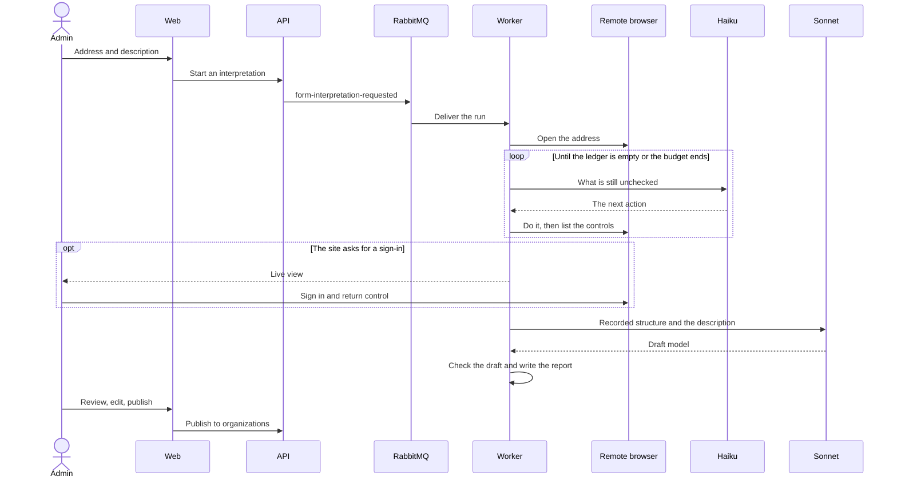
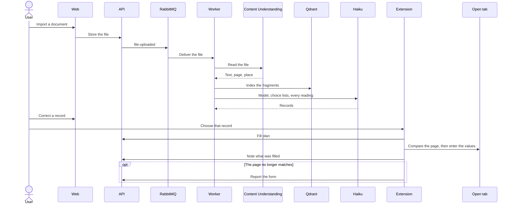
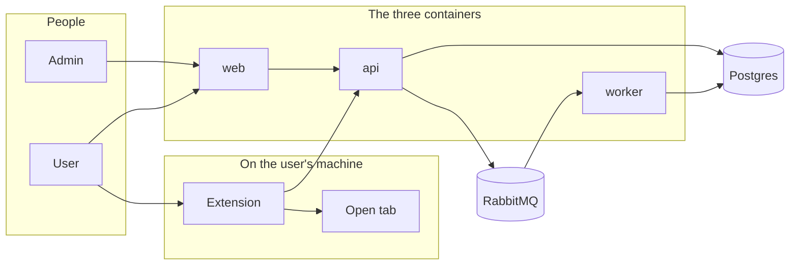
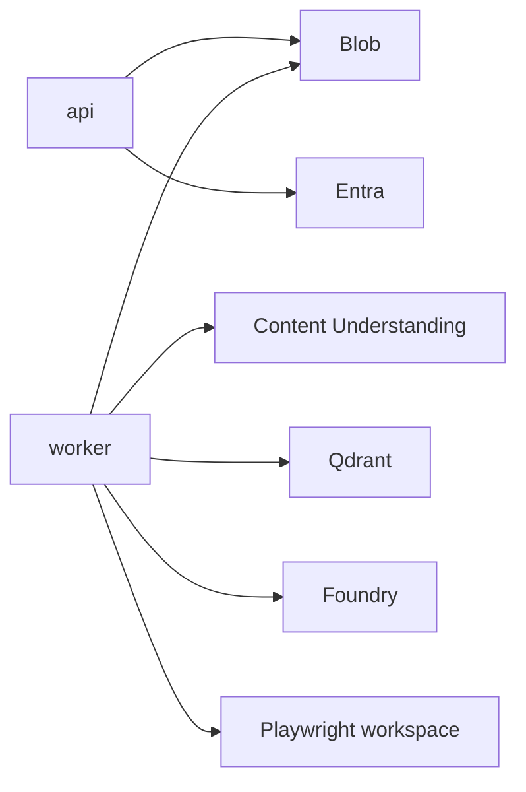
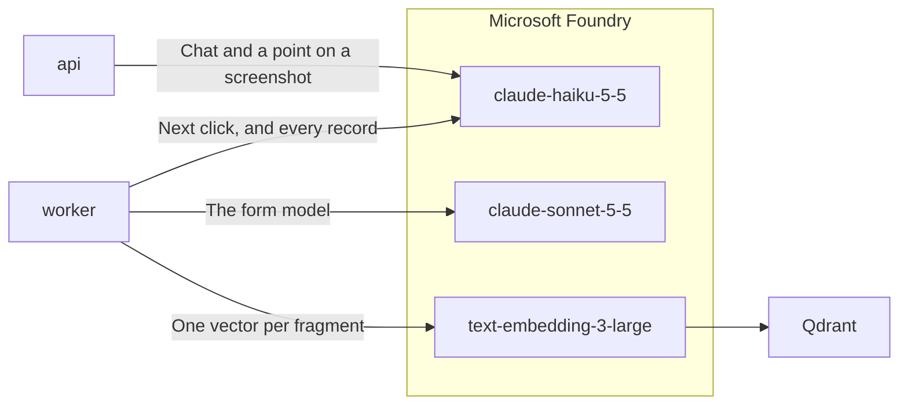

# eisenberg

An organization keeps documents. Somewhere else, on a site this product does not own, its people fill in a form. The form is not known in advance. It can be any public page, including one that asks the person to sign in first.

eisenberg learns that form once, reads the organization's documents, and then fills the open page from what the documents say. The values that were typed stay on the other website. This application only remembers that a form was filled, and a short summary of which record was used.

Three people-shaped jobs sit on top of that:

- An **admin** prepares forms, organizations, and users.
- A **user** imports documents, checks the records, and reports when the organization's settings do not match what a form is asking.
- The **extension**, used only by a user, writes one chosen record into the browser tab that is already open.

There is no chat on the website. Filling is not a chat message.

## What a model is

A model is the shape of a form, with no values of its own. Interpreting a form produces it. It is closer to a set of types than to a screenshot.

A **property** is one fact the form asks for. It has a name and a description of that fact. The name is not the sentence printed on the page. The page sentence is stored separately, because the extension has to find the control later. A property also records the kind of value, whether it is required, its limits, the condition under which it is shown, and which other properties must be filled first.

Where the form offers choices, the property points at a **choice list**. Each choice has the value the form stores and the text the page shows. Lists are kept apart from the model so they can be large, and so a list that depends on earlier answers can stay incomplete when the interpretation runs out of budget. An incomplete list is still usable: at fill time the extension matches the record's value against the options the page is showing.

A **record** is one instance of one type in the model. One model has many records. The values in a single record may come from different documents. The user can correct a generated record and can add one by hand, using a type the published model actually has.

Users only see a model after the admin publishes it. A later interpretation creates a new draft. The published model stays in use until the admin publishes another one.

## Learning a form

The admin adds the address and a description. The description says what the form is for, how to reach it after signing in, what must not be clicked, and any test values the site will accept. The interpretation then runs in the background. The admin page shows its progress.

The worker opens the address in a remote browser. The browser is a Playwright workspace. It does not see the admin's own session, and it cannot open an address that is not public. The worker leads the pass: it asks Claude Haiku 5.5 what to click next, runs a fixed script after every action to list the controls and the choices, and keeps a ledger of what has not been checked. The model does not decide that the pass is finished. The pass ends when nothing is left to check, or when it hits a budget of 400 actions, 60 minutes, or 60 options on one control.

Moving to the next step is allowed, even when the site saves the entered values. The final submit is not clicked. Credentials are not stored. When the site requires signing in, the run pauses and the admin gets a live view of that remote browser, signs in there, and hands control back. If nobody signs in within 15 minutes, the session is idle and the run ends. The next run starts from a fresh browser.

After the pass, Claude Sonnet 5.5 builds the model from the recorded structure and the admin's description. Values that were already sitting in the form are not sent to it. The worker then checks its own result: controls that were seen must be properties or marked ignored, complete choice lists must match what the script listed, and the report says where the pass stopped. The draft, the choice lists, a screenshot of each state, and the report are stored for the admin.

The admin can rename properties, change descriptions and types, mark controls as ignored, change the description, and start again. Publishing attaches the model to one or more organizations.



A site that shows a CAPTCHA, or that blocks automated browsers, stops the run. The report says so. The remote browser has no fixed address, so a site that limits visitors by location can refuse it.

## Reading documents and filling the page

A user imports files for an organization they belong to, and deletes only the files they uploaded. Nobody else in that organization sees those files. Records are different: they are built from every reading in the organization, and every member can see them.

Azure Content Understanding, in standard mode, reads a file. The reading keeps the text, the page, and the place on the page. Those fragments are written to Qdrant with the file and the organization, so they can be replaced later. Claude Haiku 5.5 then receives the published model, its choice lists, and the readings of the whole set of documents, not only the closest search hits. It returns every record it can build and chooses the subclass for each one. A complete choice list must be answered with one of its stored choices. An incomplete list keeps the value as the documents state it.

The user sees those records as fields, not as raw JSON. A value that the reading can locate shows the document, the page, and the place. Saving a correction is checked against the model, and a rejected value is shown on that field.

Filling happens only in the extension, on Chrome or Edge. The user opens the form themselves. The extension does not open it. They pick one record. The extension asks the API for a fill plan: the order of fields, the text on the page, and how to find each control. It then clicks, types, and reads the page through the Chrome DevTools Protocol. If a control cannot be found in the page structure, Haiku looks at a screenshot and the extension clicks the point it returns.

Before that, the extension compares the open page with the structure stored on the model. When the page no longer matches, it files a form-change report. The admin starts a new interpretation from that report. The old published model stays in use until the new one is published.



A settings report is a separate thing. The user can read each organization's settings text and can report that something does not match, and what information is required. The admin replaces that text. Content Understanding is not part of the text. It has its own switches: one for everyone, one on a user, and one on an import. The most specific switch that has a value wins.

## Architecture

Two services run on the server. `api` is the only HTTP door. `worker` has no public site. The website is a third container, but it is not a service: nothing calls it to do work. The extension is not a container at all.

`data` is the class library both services reference. It is not deployed alone. One PostgreSQL schema means the API can insert a file row and the worker can update that same row after reading it.



The website and the extension never receive the keys for Foundry, Blob, Qdrant, RabbitMQ, or the Playwright workspace. The browser does not call the API at an address compiled into the page. It calls the website, and the website container forwards that call to `API_BASE_URL`. `PUBLIC_API_URL` is the address the extension uses, copied from the website when the user opens it. `WEB_ORIGIN` is the public address of the website, and the API allows that origin besides localhost and the extension.

Outside the three containers, the worker is the one that talks to the document and browser services. The API stores bytes and checks Entra tokens. Neither service creates those accounts.



RabbitMQ carries only two kinds of message.

| Queue | Meaning |
|---|---|
| `file-uploaded` | A file was stored. The worker should read it and rebuild records. |
| `form-interpretation-requested` | The admin started an interpretation. The worker should open the form. |

## What each part owns

**`web`** is Next.js and React, in English. The admin panel is the overview of work that is waiting, organizations, users, forms, reports, and document reading. The user panel is documents, records, filled forms, and settings. A form page shows the run, the live view while a sign-in is waiting, the report, the screenshots, the editable draft, the choice lists, and publishing. The website does not upload files for an admin, and it does not edit or delete a filled-form note.

**`api`** is ASP.NET Core on .NET 11. It owns organizations, users, memberships, settings text, file metadata, filled-form notes, settings reports, form-change reports, forms, runs, model versions, choice lists, and publications. Upload stores the bytes, inserts the row, and publishes `file-uploaded`. Starting an interpretation inserts the run and publishes `form-interpretation-requested`. The API does not open the form and does not read the document. It also exposes one chat endpoint, and only the extension may call it.

**`worker`** is the other .NET 11 process. For a file it sets the status to processing, decides from the three Content Understanding switches whether to read it, calls Content Understanding, writes Qdrant, and builds records. For an interpretation it drives the remote browser, keeps every state and every action so the pass can be repeated if the browser session dies, asks Sonnet for the model, checks the draft, and stores the report. It does not serve the website or the extension.

**`extension`** is Manifest V3. The user selects one record of the published model. The extension enters it into the open tab. It does not open that page, does not hold service keys, and does not start an interpretation.

**`data`** is the EF Core library behind both services: the tables above, plus the global Content Understanding switch.

## Microsoft Foundry

Microsoft Foundry is where the models run. It is not part of the website, and it is not the program that clicks through a form. The subscription owner creates one Foundry resource and the deployments on it. This application does not create that resource. The region chosen for it is West Europe. The endpoint URL is whatever that resource has. `FOUNDRY_ENDPOINT` and `FOUNDRY_API_KEY` are the only two values that mean "Foundry is connected." Both stay in `api` and `worker`. The browser never sees them.

One resource hosts several deployments. The deployment name picks the model. A name that starts with `claude` is called through Foundry's Anthropic Messages API, `{endpoint}/anthropic/v1/messages`. Any other name is called through the OpenAI chat API, `{endpoint}/openai/v1/chat/completions`. Embeddings are a third shape, `{endpoint}/openai/deployments/{name}/embeddings`. The same key is sent as `api-key` on all three.



**Haiku walks the form.** During an interpretation the worker keeps the ledger of what is still unchecked. Each turn it sends that state to the deployment named by `FOUNDRY_AGENT_DEPLOYMENT`. When the variable is empty, the name is `claude-haiku-5-5`. Haiku answers with the next action. The worker performs it in the Playwright workspace and runs the inventory script. Haiku does not hold the browser, and there is no hosted Foundry agent in this path. The pass does not start at all when the endpoint, the key, or the Playwright workspace is missing. The run is then marked not connected.

**Sonnet builds the model.** When the pass has a recorded structure, the worker calls the deployment named by `FOUNDRY_MODEL_DEPLOYMENT`. When the variable is empty, the name is `claude-sonnet-5-5`. The call contains the page structure and the admin's description. Values that were already filled in on the page are not included. Sonnet returns the types, the properties, and the choice lists. The worker checks that draft before the admin sees it.

**Haiku builds the records.** After documents have been read, the worker calls the deployment named by `FOUNDRY_CHAT_DEPLOYMENT`, again `claude-haiku-5-5` when the variable is empty. The call contains the published model, its choice lists, and the readings of the whole set of documents for that organization. Haiku returns every record it can build, including which subclass each one is. This call does not go through the chat endpoint.

**Haiku serves the extension.** The API uses that same chat deployment for two smaller calls. `POST /chat` sends one message and returns the text. Only the extension may call it, and the website has no chat. If the endpoint or the key is empty, the answer is the fixed sentence "The model is not connected." When a control cannot be found in the page, the extension posts a screenshot. The API asks Haiku for a point, and the extension clicks it. With no Foundry connection that call returns no point.

**Embeddings are also a Foundry deployment.** The worker writes one vector per fragment of a reading. The deployment name is `FOUNDRY_EMBEDDING_DEPLOYMENT`, and it defaults to `text-embedding-3-large`. Vectors are stored in Qdrant. Foundry has no connector for Qdrant, so the worker does the write. Embeddings run only when the endpoint, the key, and `QDRANT_URL` are all set. Until then the reading is kept, and the records are still built from the whole text rather than from a search.

When the endpoint or the key is empty, none of these calls are made. A plain-text file can still become a reading, and records can still be matched from it locally. A PDF waits. An interpretation does not start. Setting the two Foundry values, and the deployment names only where a default is wrong, is what turns those calls on.

## Stack

| Concern | What it is, and why it is here |
|---|---|
| Screens | React and Next.js. Two roles, admin and user. |
| Login | Microsoft Entra External ID, because the users are customers. Until both Entra values are set, and only while development login is on, a header selects a seeded admin or a seeded user. |
| Services | .NET 11 and ASP.NET Core, one container each for `api` and `worker`. |
| Website container | The Next.js application. It is not a microservice. |
| Database | PostgreSQL through EF Core. Neon when `DATABASE_URL` points there. A Postgres container is the local stand-in. |
| Queue | RabbitMQ, with the .NET client. Locally it runs in Docker. |
| File bytes | Azure Blob Storage. A local folder until `BLOB_CONNECTION_STRING` is set. The API and the worker share that folder in the local Compose file. |
| Reading | Azure Content Understanding, standard mode. Pro mode is not used. |
| Search index | Qdrant. Foundry cannot write it, so the worker does. Embeddings default to `text-embedding-3-large`. |
| Models | Haiku 5.5 walks the form, builds records, and looks at a screenshot when a control cannot be found. Sonnet 5.5 builds the model. Both are Foundry deployments. |
| Remote browser | A Playwright workspace. The worker calls its remote MCP endpoint. The click loop is code in the worker. |
| Place they run | Docker for the three containers. Kubernetes is the intended place after testing. The cluster itself is not chosen. |

Empty settings mean that step is not connected. The process still starts. An interpretation without Foundry or the Playwright workspace is marked not connected and stops. A binary file, such as a PDF, stays stored until Content Understanding is connected. A plain-text file can still be read locally, and records can still be matched from that reading, so the rest of the path can be tried before those accounts exist. Haiku replaces that matching as soon as Foundry is set. The application does not create any of those accounts. The names of the settings are in [.env.example](.env.example).

## Running it

Locally, Postgres and RabbitMQ come up with the three containers, and the development switch stays available:

```text
docker compose -f infra/docker-compose.yml up
```

For a real deployment, development login is off. Postgres, RabbitMQ, and the Azure services are expected to already exist. Their addresses are the environment, not this Compose file.

```text
docker compose -f infra/docker-compose.prod.yml up
```

The same three workloads are described for Kubernetes in [infra/k8s/eisenberg.yaml](infra/k8s/eisenberg.yaml).

## The longer documents

[docs/product-plan.md](docs/product-plan.md) is the product and the technical plan. [docs/form-model-specification.md](docs/form-model-specification.md) specifies the model, the interpretation, the records, and the extension. [docs/decisions.md](docs/decisions.md) records the choices that were made where the plan left a question open. Any of those choices can change.
